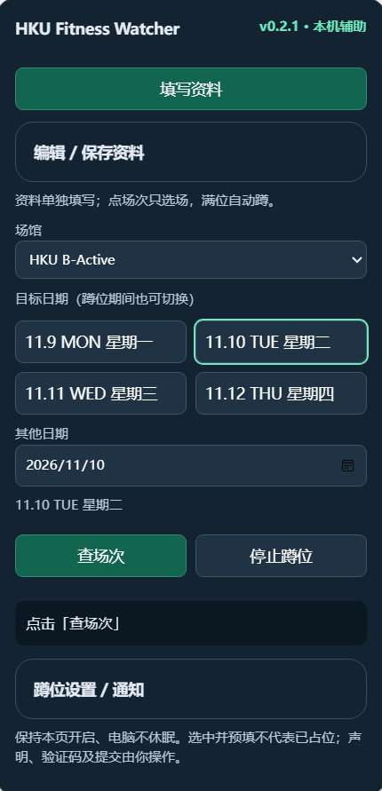
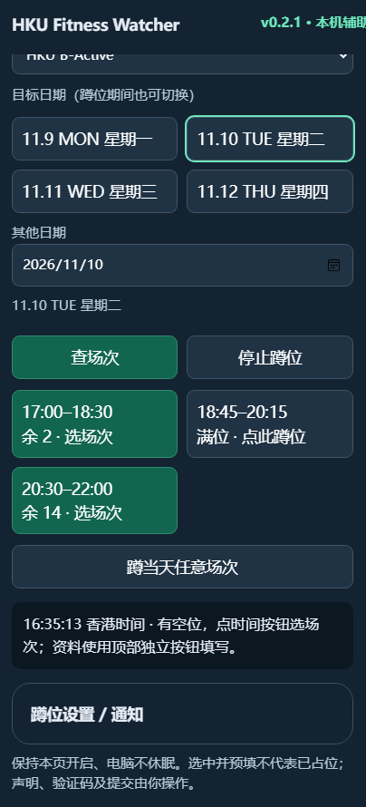
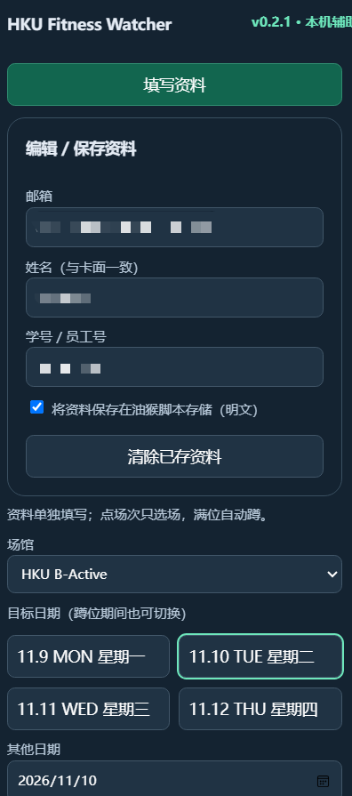
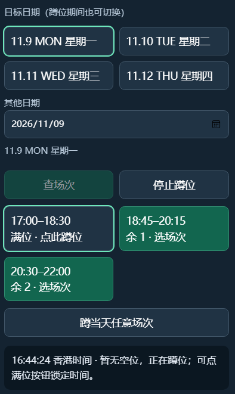
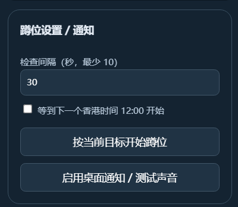
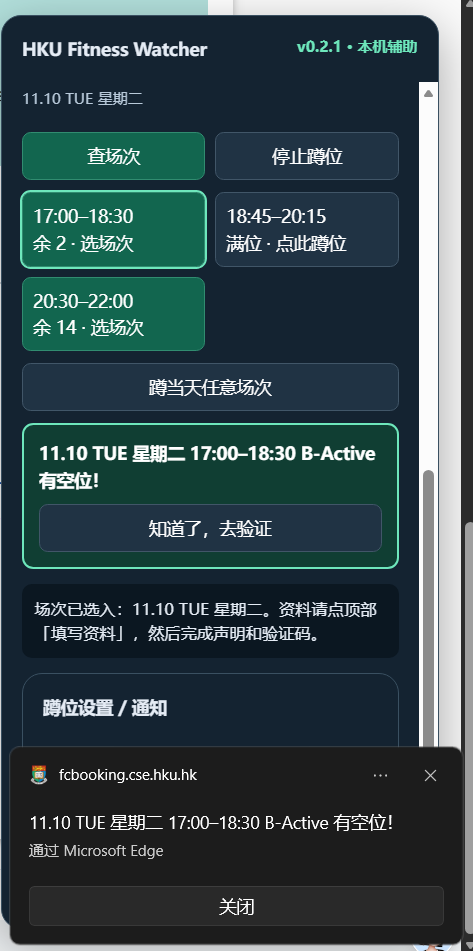
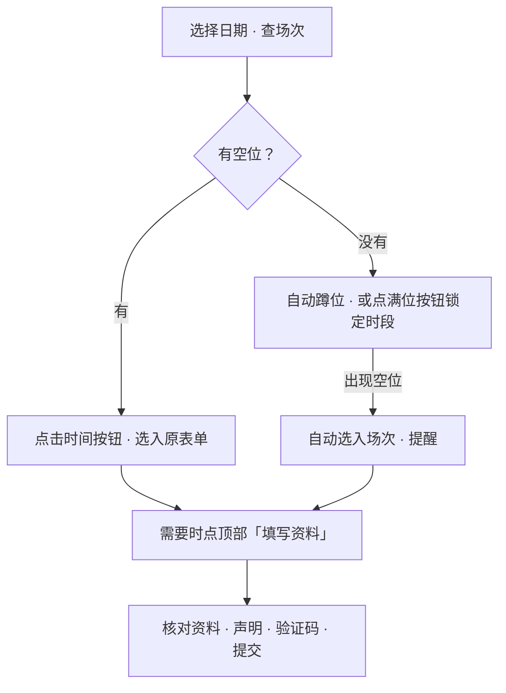

<div align="center">

# 🏋️ HKU Fitness Watcher

**少点几次，少等一步。**

港大健身房蹲位与填表助手 · 直接运行在原预约页上


[安装脚本](https://raw.githubusercontent.com/os-till-go/HKU-Fitness-Watcher/main/fitness-watcher.user.js) · [打开预约页](https://fcbooking.cse.hku.hk/Form/Signup) · [功能预览](#功能预览) · [快速开始](#快速开始)

</div>

---

盯着预约页等退位、反复切日期、重新填写资料——这些步骤交给脚本。

**HKU Fitness Watcher** 将查场次、选时段、蹲退位和资料预填放到一个面板里。支持 **HKU B-Active** 和 **CSE Active**，默认选择 B-Active。

> 选场次和填写资料各有独立按钮；声明、验证码与最终提交仍由你完成。看到空位或选中场次，都不代表已经占位。

## 功能预览

| | 功能 | 怎么用 |
| :-- | :-- | :-- |
| 📅 | **日期直接点** | 日期按钮显示 `11.10 TUE 星期二`，点一下就切换并查询；蹲位中也能改日期 |
| 🕒 | **场次直接选** | 时间按钮显示余位；有位就选入原表单，满位就开始蹲该时段 |
| 👀 | **没位自动蹲** | 查询后没有可订场次，自动监测当天任意场次；也可锁定一个时段 |
| 🔔 | **有位立即提醒** | 发现空位后停止监测、选入场次，并发出声音、页内提示和可选桌面通知 |
| ✍️ | **资料独立填写** | 顶部「填写资料」一键填入邮箱、姓名及学号；可选择保存供下次复用 |
| 🕛 | **等中午放位** | 可等到下一个香港时间 12:00，再开始查询目标日期 |

### 截图

下面是 v0.2.1 的实际使用界面。图中的日期和余位为截图时的状态。

<table>
<tr>
<td width="50%" align="center" valign="top">
<strong>① 面板总览 · 日期直接点</strong><br><br>
<a href="docs/screenshots/01-overview.png"></a><br>
<sub>默认 B-Active，切换日期即查询。</sub>
</td>
<td width="50%" align="center" valign="top">
<strong>② 场次与余位 · 一眼看清</strong><br><br>
<a href="docs/screenshots/02-sessions.png"></a><br>
<sub>有位点选场次，满位点一下就开始蹲。</sub>
</td>
</tr>
<tr>
<td width="50%" align="center" valign="top">
<strong>③ 资料填写 · 独立一个按钮</strong><br><br>
<a href="docs/screenshots/03-profile.png"></a><br>
<sub>资料可选保存；随时点顶部按钮填入。</sub>
</td>
<td width="50%" align="center" valign="top">
<strong>④ 锁定时段 · 等待退位</strong><br><br>
<a href="docs/screenshots/04-watching.png"></a><br>
<sub>只蹲选中的 17:00 场次，其他时段有位也不会跳选。</sub>
</td>
</tr>
<tr>
<td width="50%" align="center" valign="top">
<strong>⑤ 查询间隔 · 中午放位</strong><br><br>
<a href="docs/screenshots/05-settings.png"></a><br>
<sub>按需设置查询间隔、12 点开始和桌面通知。</sub>
</td>
<td width="50%" align="center" valign="top">
<strong>⑥ 有空位！· 回来完成验证</strong><br><br>
<a href="docs/screenshots/06-notifications.png"></a><br>
<sub>场次已选入；回到页面核对、验证并提交。</sub>
</td>
</tr>
</table>

点击任意截图可查看原图。

## 快速开始

### 1 · 安装

在 Chrome / Edge 安装 [Tampermonkey](https://www.tampermonkey.net/)，然后打开：

**[→ 安装 HKU Fitness Watcher](https://raw.githubusercontent.com/os-till-go/HKU-Fitness-Watcher/main/fitness-watcher.user.js)**

如果没有弹出安装页面：进入 Tampermonkey 管理面板 → 新建脚本 → 删除默认内容 → 粘贴 [脚本源码](fitness-watcher.user.js) → `Ctrl + S` 保存。

打开或刷新 [HKU 健身房预约页](https://fcbooking.cse.hku.hk/Form/Signup)，右上角即可看到助手面板。如果没有出现，检查扩展是否允许在该网站运行，并按 Tampermonkey 提示开启用户脚本权限。

### 2 · 准备资料

展开顶部「编辑 / 保存资料」，输入邮箱、卡面姓名、学号 / 员工号，再点 **「填写资料」**。

需要下次复用时勾选保存。也可以直接复用原表单里已输入的资料。填写资料不要求先查询或选场次，蹲位期间也可以使用。

### 3 · 查场次，或蹲一个时段



- **有位**：点时间按钮即可选入场次。
- **没位**：自动开始蹲当天任意场次；只想要一个时段，就点对应的满位按钮。锁定时段后，“暂无空位”指该目标场次；其他时段仍可能有余位。
- **换日期**：直接点日期按钮或修改日期输入框。旧查询和旧监测会被取消，自动查询新日期。
- **停止**：点击「停止蹲位」。刷新页面后不会自动恢复监测。

### 4 · 打开提醒

在「蹲位设置 / 通知」中点击「启用桌面通知 / 测试声音」，并允许浏览器通知。

通知示例：

> **11.10 TUE 星期二 17:00–18:30 B-Active 有空位！**

页内提示没有自动关闭计时，会保留到你点击确认；刷新、离开页面或切换目标也会清除提示。桌面通知会请求常驻，是否一直显示取决于浏览器和操作系统。

<details>
<summary><strong>中午 12 点放位怎么蹲？</strong></summary>

选择目标日期，展开「蹲位设置 / 通知」，勾选「等到下一个香港时间 12:00 开始」，再点击「按当前目标开始蹲位」。

目标日期尚未发布时，也可以提前设置。中午已过时，这个选项会等到次日中午；「查场次」始终立即查询。

</details>

## 资料与运行方式

**本机运行，无需部署后端。**

- 场次查询使用原网页的只读接口；查询请求不附带姓名、邮箱或学号。
- 个人资料默认只留在当前页面内存。勾选保存并点击「填写资料」后，才会存入 Tampermonkey 脚本专属存储（明文）。
- 取消保存勾选或点击「清除已存资料」，可删除已存副本。填入原表单后，网站脚本可以读取这些内容。
- 默认每 **30 秒**查询，最少 **10 秒**。请只开一个监测标签页，并保持电脑不休眠；后台标签页可能延迟。
- 网络错误会降低查询频率，连续五次错误停止；HTTP 401 / 403 / 429 会立即停止。
- Walk In 与网站标记为不可预约的场次不会触发有位提醒。

## 本地模拟与开发

需要 **Node.js 22+**，无第三方依赖，无需 `npm install`。

```bash
git clone https://github.com/os-till-go/HKU-Fitness-Watcher.git
cd HKU-Fitness-Watcher
npm test
npm run check
node demo/server.cjs
```

打开 [本地模拟页](http://localhost:8765)。模拟接口前三次查询满位，第四次放出一个名额，方便测试蹲位、自动选场、提醒与独立填资料。模拟页只提供当天场次，不会连接 HKU 或产生真实预约；重启服务即可重置查询次数。

```text
fitness-watcher.user.js   油猴脚本
 demo/server.cjs          本地模拟页与场次接口
 tests/                  匹配、取消请求、蹲位、通知与资料填写测试
 docs/screenshots/        实际使用截图与图注
```

当前包含 **16 项本地测试**，覆盖日期切换、旧请求取消、满位后放位、独立填写资料、通知常驻选项、限流与存储。流程测试使用轻量 DOM 适配器；真实预约提交与真实退位事件尚未端到端验证。

---

<sub>个人辅助工具，与 HKU / CSE 无隶属或官方合作关系。请按场馆预约规则使用，并以原网站的预约结果为准。</sub>
